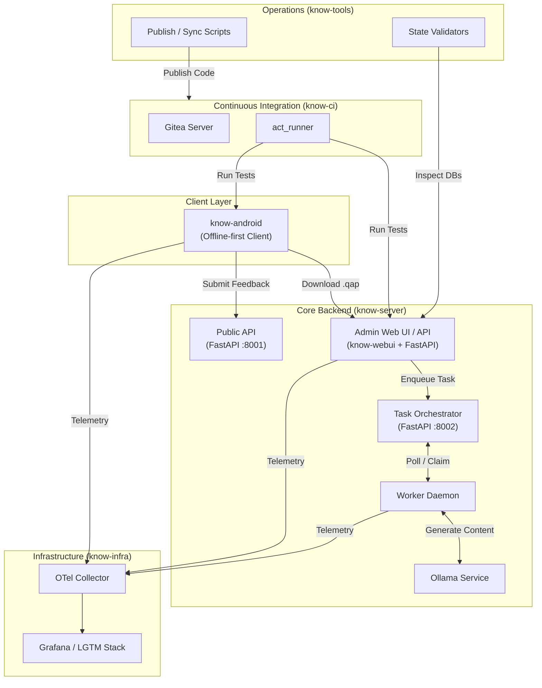

# Know: Knowledge Never Overwhelms Wisdom

**Know** is an offline-first, AI-assisted learning platform designed to combat information overload. Instead of feeding users an endless stream of articles, Know generates structured, domain-specific quizzes and concise technical articles. 

The system is built around **Quiz Asset Packages (`.qap`)** — portable, versioned knowledge bundles generated by LLMs, validated on the backend, and served to mobile clients for fully offline consumption.

## The Ecosystem

The Know project is split into five specialized repositories:

| Repository | Role | Key Tech |
| :--- | :--- | :--- |
| **[know-server](https://github.com/v-at-gh/know-server)** | Core backend, task orchestrator, content generation pipeline, and admin panel. | Python, FastAPI, SQLite, Ollama |
| **[know-android](https://github.com/v-at-gh/know-android)** | Native mobile client. Offline-first quiz engine and article reader. | Kotlin, Jetpack Compose, Room |
| **[know-infra](https://github.com/v-at-gh/know-infra)** | Centralized telemetry, logging, and tracing stack. | LGTM (Loki, Grafana, Tempo, Prometheus) |
| **[know-ci](https://github.com/v-at-gh/know-ci)** | Self-hosted CI/CD infrastructure. | Gitea, act_runner, Docker |
| **[know-tools](https://github.com/v-at-gh/know-tools)** | Cross-repository operational scripts, sync pipelines, and host utilities. | Python, Bash, PowerShell |

## System Topology

The following diagram illustrates how the components interact in a production-like environment:

## Repository Breakdown

### 1. [know-server](https://github.com/v-at-gh/know-server)
The heart of the ecosystem. It manages the content generation pipeline (using local Ollama LLMs to generate quiz questions and vector embeddings), compiles `.qap` release packages, and serves both the Admin UI (Jinja + React) and the Public API (for mobile feedback).
*   **Entry point:** `python tools/dev_launcher.py`

### 2. [know-android](https://github.com/v-at-gh/know-android)
A Jetpack Compose application built for deep focus. It features a custom quiz engine that supports both multiple-choice and token-assembly questions, backed by a dual-database architecture (Read-only `content.db` for curriculum, Read-write `user.db` for progress). Deep links allow one-tap `.qap` pack installation.
*   **Entry point:** `./gradlew :app:assembleDebug`

### 3. [know-infra](https://github.com/v-at-gh/know-infra)
Provides full observability for the ecosystem. It routes OTLP telemetry from the server and the Android app into Prometheus (metrics), Loki (logs), and Tempo (traces), visualized via Grafana. Includes pre-provisioned dashboards for monitoring the orchestrator queue depth and worker health.
*   **Entry point:** `docker compose up -d`

### 4. [know-ci](https://github.com/v-at-gh/know-ci)
A self-hosted Gitea instance paired with `act_runner` daemons. It runs Python tests, Gradle builds, and infrastructure validation locally, avoiding external SaaS costs while maintaining GitHub Actions workflow compatibility.
*   **Entry point:** `docker compose --profile runner up -d`

### 5. [know-tools](https://github.com/v-at-gh/know-tools)
The glue that holds the ecosystem together. It contains the host-level PowerShell port-forwarding scripts for Windows hypervisors, and read-only SQLite state validators.

## Development Workflow

To spin up the full local development environment:

1. **Start Infrastructure (Telemetry):**
   Clone `know-infra` and run `docker compose up -d`.
2. **Start CI (Optional):**
   Clone `know-ci`, build the Android runner image, and start the Gitea stack.
3. **Run Backend Services:**
   Clone `know-server`, configure `.env`, and run `python tools/dev_launcher.py`. This starts the Admin Panel, Public API, Orchestrator, and Worker.
4. **Build the Android Client:**
   Clone `know-android`, set `ANDROID_HOME`, and run `./gradlew :app:assembleDebug`. Install it on an emulator or device.

## Security & Privacy
*   **Private by Default:** The content generation pipeline runs entirely on local LLMs (Ollama).
*   **Data Isolation:** `know-tools` enforces strict allow/deny lists during repository synchronization to prevent secrets (`.env`, `*.db`) from leaking into public repositories.
*   **Telemetry Opt-out:** The Android client supports offline-only mode, and telemetry endpoints in the backend are fully configurable.